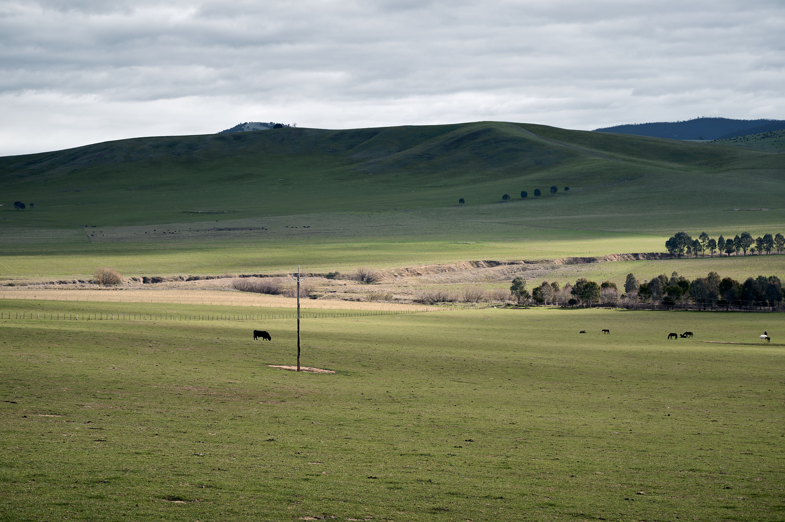

# Do ground photos improve rangeland cover estimates?

Station managers and grazing advisers use maps of **ground cover** to judge grazing pressure and erosion risk. These maps split the ground into three parts that add up to 100%:

- **Green**: living plants
- **Dry**: dead grass and litter
- **Bare**: bare soil

The maps come from satellite images. TERN AusPlots also has thousands of **photos taken on the ground** at survey sites. This project asks one question:

> **Do ground photos make green, dry and bare cover estimates more accurate than satellite and weather data alone?**

A "no" is still a useful answer. It tells a mapping team whether the photo archive is worth using.

<p align="center">
  
  <br>
  <em>Photo by <a href="https://www.pexels.com/photo/cattle-on-a-large-pasture-in-mountains-8229754/">Gilberto Olympio</a> on Pexels.</em>
</p>

## Status

| Stage | State |
|---|---|
| Labels, photos, satellite crops, weather | ✅ Downloaded (378 candidate visits) |
| Join into one dataset | ✅ Done (358 visits) |
| Photo features, models, results | ✅ Done (Colab run, 17 Nov) |

**Verdict: FAIL.** With photos, the dry-cover error drops 0.92 points (the pass mark needs 1.5), and method 3 wins in 11 of 15 test runs (it needs 12).

**FAIL does not mean that the photos do not help:**
- With photos, all three errors fall: green by 1.64, dry by 0.92 and bare by 0.32 cover points. A bootstrap over the 336 sites gives a 95% range of +0.37 to +1.82 for the dry gain. The range does not include zero.
- The best method is the linear model (method 4, dry error 12.37), and it uses the photos. No linear model without photos was run, so the photo gain inside the best model is not measured.

**The linear model is better than both random forests with photos.** Its dry error (12.37) is 2.20 points lower than method 2 (14.57), which is more than the 1.5 pass mark. Its green error (8.68) is also much lower than method 3 (11.15). This is **not a pass**. The pass mark is frozen and compares method 3 with method 2 only, and method 4 has no matching version without photos. So the verdict stays FAIL. The result does show that the model type matters at least as much as the photos in this dataset. See "Future work".

Full table, chart and notes: [`results/results.md`](results/results.md).

## How it works

```
 Ground survey (AusPlots) ──► labels: green / dry / bare
 Ground photos (EcoImages) ─► 18 photos per visit ─► DINOv2 features ─┐
 Sentinel-2 satellite ──────► 10×10 pixel crop, 6 bands ──────────────┼─► models ─► error (MAE)
 SILO weather ──────────────► 12 months of rain and temperature ──────┘
```

1. **Labels.** For each field visit, the percentage of green, dry and bare ground. These come from the surveyors' point counts.
2. **Inputs.** For the same visit: a satellite crop of the plot, the weather for the 12 months before, and 18 ground photos.
3. **Models.** Four methods, which differ only in their inputs:

   | # | Model | Inputs |
   |---|---|---|
   | 1 | Random forest | Satellite |
   | 2 | Random forest | Satellite + weather |
   | 3 | Random forest | Satellite + weather + **photos** |
   | 4 | Linear model | All inputs |

4. **Testing.** Each method is scored on 15 test runs. In every run, the test sites are sites the model never saw during training.
5. **Verdict.** The main comparison is **method 3 against method 2**. The photos "pass" only if **all three** of these are true:
   - the dry-cover error drops by **1.5 points or more**;
   - method 3 beats method 2 on dry cover in **12 or more of the 15** test runs;
   - the green and bare errors rise by **no more than 0.5 points**.

The pass mark and method list were committed to git **before any model ran**, so the verdict cannot be tuned to the results. The results page also gives notes beside the verdict (each error's change with photos, a range for the dry gain and the best method). They are context and never change the verdict.

## The data

| Source | What it gives | Account needed |
|---|---|---|
| [TERN AusPlots](https://www.tern.org.au/tern-observatory/tern-ecosystem-surveillance/) (via the `ausplotsR` R package) | Cover labels | No |
| [TERN EcoImages](https://ecoimages.tern.org.au/) | Ground photos | No |
| [Sentinel-2](https://developers.google.com/earth-engine/datasets/catalog/COPERNICUS_S2_SR_HARMONIZED) via Google Earth Engine | Satellite images | Yes (Earth Engine Cloud project) |
| [SILO](https://www.longpaddock.qld.gov.au/silo/) | Daily weather | No (an email address is the username) |

**Which visits are used:** surveys from 28 March 2017 onwards, on plots laid out north–south, with photos taken within 7 days of the survey, and a cloud-free satellite image within 30 days. That leaves **358 visits**.

The reasons behind every rule are in [docs/decisions.md](docs/decisions.md). Facts and counts about each source are in [docs/data.md](docs/data.md).

## Project layout

```
R/extract_labels.R            Step 1: labels and the list of visits
src/rangecover/data/
├── photos.py                 Step 2: download 18 photos per visit
├── sentinel2.py              Step 3: download one satellite crop per visit
└── weather.py                Step 4: download SILO weather
docs/
├── decisions.md              Every choice, with the options and the reason
└── data.md                   Facts about each data source
instructions.md               Setup cell for Google Colab
data/                         Downloaded data (not in git; lives on Google Drive)
```

Coming next: `build_dataset.py`, `features.py`, `splits.py`, `models.py`, `evaluate.py`, `notebooks/main.ipynb`, `tests/` and `results/`.

## Run it yourself

### 1. Install the tools

You need:
- [uv](https://docs.astral.sh/uv/) (installs Python 3.13 and the packages for you)
- [R](https://www.r-project.org/) with the `ausplotsR` and `jsonlite` packages

```bash
git clone https://github.com/ishxn69/rangeland-photo-fusion-model.git
```

```bash
cd rangeland-photo-fusion-model
```

```bash
uv sync
```

### 2. Add your settings

Create a file called `.env` in the project folder:

```
SILO_EMAIL=you@example.com
EE_PROJECT=your-earth-engine-cloud-project
```

Then sign in to Earth Engine once:

```bash
uv run earthengine authenticate
```

By default, data is saved to `data/` in the project folder. To save it somewhere else, set the `DATA_DIR` environment variable.

### 3. Download the data

Run these in order, from the project folder. Each script **resumes**: if you stop it and run it again, it skips files that already exist.

```bash
Rscript R/extract_labels.R
```

```bash
uv run python src/rangecover/data/photos.py
```

```bash
uv run python src/rangecover/data/sentinel2.py
```

```bash
uv run python src/rangecover/data/weather.py
```

| Script | Saves | Time |
|---|---|---|
| `extract_labels.R` | `data/labels.csv`, `data/visits.csv` | Minutes |
| `photos.py` | `data/photos/` (~6,800 photos, ~0.5 GB) | Hours; leave it running |
| `sentinel2.py` | `data/sentinel2.npz` | Under an hour |
| `weather.py` | `data/weather.csv` | Minutes |

### 4. Run on Google Colab (optional)

Copy the setup cell from [instructions.md](instructions.md) into the top of the notebook. It mounts Google Drive, points `DATA_DIR` at the data there, and installs the locked packages.

## Known limits

- The labels describe the **ground layer** (grass, litter, soil), not tree tops. The satellite sees tree tops, so at wooded sites part of any photo gain comes from things the satellite cannot see.
- Cape York visits from mid-2018 are missing, because the satellite collection has no images there for those months.
- 378 candidate visits fall to 358 because 20 have no cloud-free satellite crop.
- **The random forests may be a weak choice for this data (not tested).** The linear model beat both forests that use photos on green and dry cover. We did not test why. Possible reasons: the dataset is small (358 visits) and the forests ran with default settings and no tuning; the 20 photo columns come from PCA of the DINOv2 features, which are designed so that a simple linear rule can read them, and the PCA keeps only 82–83% of the photo spread; and the ridge penalty keeps the linear weights stable. If a forest is a poor fit, the photo gain measured with forests (method 3 against method 2) may be smaller than the photo gain that a better model could reach.
- **The linear model has no photo-free partner.** The method list is frozen, so there is no linear model on satellite + weather only. The photo gain inside the best model is not measured.

The full list is under "Limitations" in [docs/decisions.md](docs/decisions.md).

## Future work

These items are outside the frozen scope. They do not change the verdict.

1. **Check if linear models with all inputs beat the other benchmarks.** Run a linear model on satellite only, one on satellite + weather, and one on satellite + weather + photos, with the same 15 test runs. Then apply the 1.5 pass mark to the linear pair. This tests if the photo gain is larger with a model that suits the data, and if linear models are better than the forests in general.
2. **Find out why the forests lose.** Test the reasons in "Known limits": try a different number of PCA components (20 were used and not tuned), tuned forest settings, and a model on the photo features alone (method 5 in the plan).
3. **Split the photo gain by open and wooded sites.**
4. **Rerun methods 2 and 3 without the 11 visits with more than 10% unlabelled cover.**

## Credits

- Labels and photos: TERN AusPlots and TERN EcoImages, under CC BY 4.0.
- Weather: SILO, Queensland Government.
- Satellite images: Copernicus Sentinel-2 data, processed by ESA, accessed through Google Earth Engine.

This is a university capstone project (due 18 November 2026).
