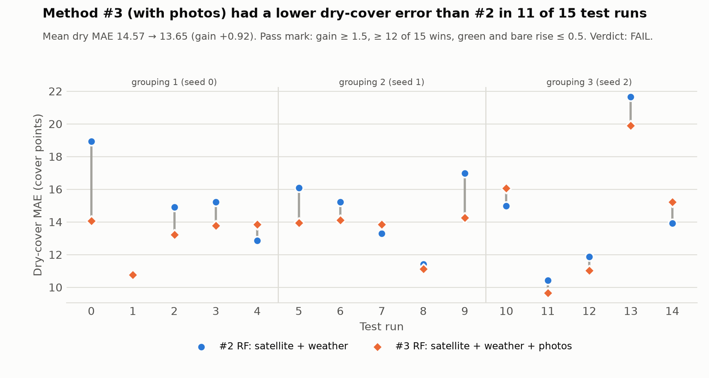

# Results

Mean over 15 site-grouped test runs, in cover points (lower is better). The pass mark uses MAE only.

| Method | MAE green | MAE dry | MAE bare | RMSE green | RMSE dry | RMSE bare |
|---|---:|---:|---:|---:|---:|---:|
| #1 RF: satellite | 12.68 | 15.14 | 10.36 | 17.77 | 19.50 | 13.79 |
| #2 RF: satellite + weather | 12.78 | 14.57 | 10.61 | 17.67 | 18.45 | 14.06 |
| #3 RF: satellite + weather + photos | 11.15 | 13.65 | 10.28 | 14.76 | 16.91 | 13.30 |
| #4 Linear: all inputs | 8.68 | 12.37 | 10.54 | 11.23 | 16.01 | 13.69 |
| Floor: training mean, no inputs | 15.69 | 22.23 | 23.31 | 20.01 | 25.70 | 26.54 |

## Verdict: method #3 against method #2

| Condition | Needed | Result | Met |
|---|---|---|---|
| 1. Dry MAE drops | ≥ 1.5 | +0.92 | no |
| 2. Runs where #3 has the lower dry MAE | ≥ 12 of 15 | 11 of 15 | no |
| 3. Green and bare MAE rise | ≤ 0.5 each | green -1.64, bare -0.32 | yes |

**Verdict: FAIL**

